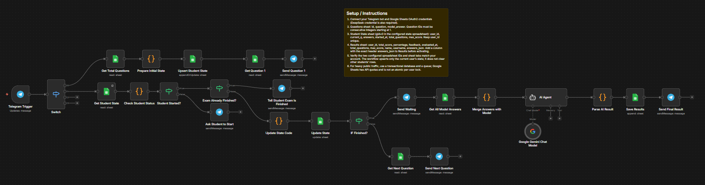

# Telegram AI Exam Bot — Essay Dynamic

A Telegram bot workflow built with n8n, Google Sheets, and Google Gemini. It delivers questions to students one at a time, stores each student's progress separately, evaluates completed answers, writes a result row, and sends the score and feedback back to the student.

> **This repository contains a sanitized workflow template and setup instructions, not a live credential bundle.** Credentials, the production spreadsheet URL/ID, Telegram bot token, Gemini key, student records, and execution data are intentionally excluded. The workflow is not ready to activate until you configure your own credentials and reselect the spreadsheet and sheet tabs in n8n.

## Workflow overview



This screenshot shows the workflow architecture from a representative run: Telegram intake, per-student state, question delivery, AI grading, and Google Sheets results. It is a visual overview only; the importable JSON template is the source of truth for current node names and configuration.

> **Screenshot note:** the embedded setup note reflects an earlier draft and mentions DeepSeek. The current sanitized template and documentation use Google Gemini.

## Repository contents

- [`INSTRUCTIONS.md`](INSTRUCTIONS.md): installation, configuration, data schema, student flow, testing, operations, and recovery instructions.
- [`SECURITY.md`](SECURITY.md): safe handling of credentials and student data.
- [`CHANGELOG.md`](CHANGELOG.md): changes represented by this repository version.
- [`workflow/ExamTelegramAIBot-EssayDynamic.template.json`](workflow/ExamTelegramAIBot-EssayDynamic.template.json): sanitized n8n import template.
- [`docs/STUDENT-GUIDE.ar.md`](docs/STUDENT-GUIDE.ar.md): short Arabic instructions for students.
- [`CONTRIBUTING.md`](CONTRIBUTING.md): safe contribution and local validation checklist.
- [`scripts/validate_repo.py`](scripts/validate_repo.py): the same safety/integrity check run in GitHub Actions.

## Quick start

1. Create one Google spreadsheet with the `Questions`, `Student State`, and `Results` tabs and the exact columns documented in `INSTRUCTIONS.md`.
2. In n8n, create Telegram Bot, Google Sheets OAuth2, and Google Gemini credentials. Do not put tokens or keys in this repository.
3. Import the workflow template. For every Google Sheets node, select your spreadsheet and the correct tab from the n8n selectors. Do not leave placeholder IDs in place.
4. Test with two separate Telegram accounts using private chats. Verify that each account has its own `user_id` state row and receives only its own question flow.
5. Activate only one workflow using a given Telegram bot token. Two active Telegram Trigger workflows sharing the same bot can conflict over the bot webhook.

## Important behavior

- Student state is keyed by Telegram `message.from.id` (`user_id`). The workflow has no shared AI memory node.
- Student commands are normalized, so `/start`, `/start@your_bot`, and surrounding whitespace work consistently. `/help` shows the exam instructions; `/cancel` explains the restart behavior without deleting state. Unknown slash commands receive the help message instead of being saved as answers.
- Stickers, photos, voice notes, and other non-text updates receive a friendly text-only reminder instead of being saved as blank answers. Question messages use plain text rather than Markdown, so student content cannot break Telegram formatting.
- Use separate private chats. Group chats are not supported: bot responses use the incoming `chat.id`, so participants in a shared group can see one another's questions and answers.
- Gemini grading is configured for up to **3 attempts total**, with **5 seconds** between attempts. This can help with transient `Service unavailable` responses, but does not guarantee recovery from a persistent outage.
- Google Sheets is suitable for a small or moderate test deployment, but it is not a transactional database. For heavy traffic, use a database and queue with per-user serialization/locking.

## Before you publish or import

Run the repository checks locally:

```bash
python3 scripts/validate_repo.py
python3 -m json.tool workflow/ExamTelegramAIBot-EssayDynamic.template.json >/dev/null
```

The GitHub Actions workflow runs the same validation on every push and pull request. After importing, assign credentials and reselect every spreadsheet and sheet tab in n8n; this repository intentionally contains placeholders and is not production-ready by itself.

## License

No license is included. Add a license only after deciding how you want others to use, modify, and redistribute this project.
